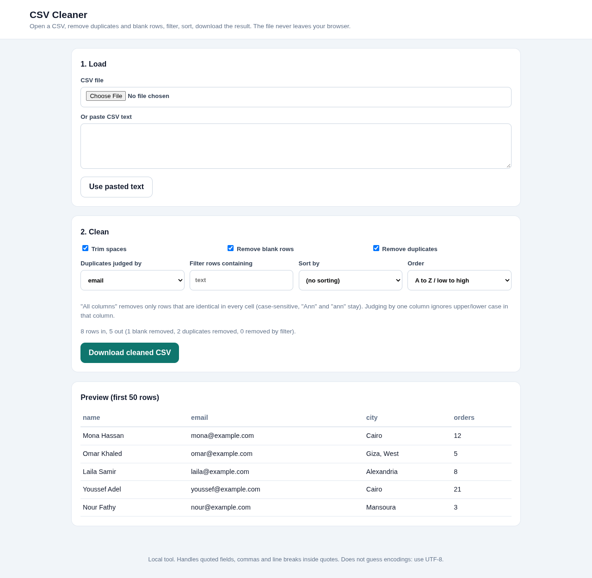

# CSV Cleaner

_Screenshot of the tool with sample data entered through the page (fictional names and numbers)._

Open or paste a CSV, remove blank rows and duplicates, trim spaces, filter, sort, and download the cleaned file. The file never leaves your browser.

## What it does
- Handles quoted fields, commas and line breaks inside quotes
- Trim spaces, remove blank rows, remove duplicates: "All columns" removes only rows identical in every cell (case-sensitive, so "Ann" and "ann" both stay); judging by one column (for example email) ignores upper/lower case in that column
- Filter rows by text, sort by a column (numeric aware)
- Download cleaned CSV; cells that start with = + - @ are neutralised so Excel does not run them as formulas
- Clear error for header-only or empty files

## Run it
Open `index.html` in a browser. No install, no build, no server, no account.

## Tests and limits
- Browser-tested in headless Chrome: 12 checks passed on the current code (they include a mobile layout check, which only proves nothing overflows).
- Data stays in this browser. Clearing site data deletes it. No sync between devices.
- Plain HTML, CSS and JavaScript, no frameworks.

Built by Mahamed Yasser.
